<p align="center">
  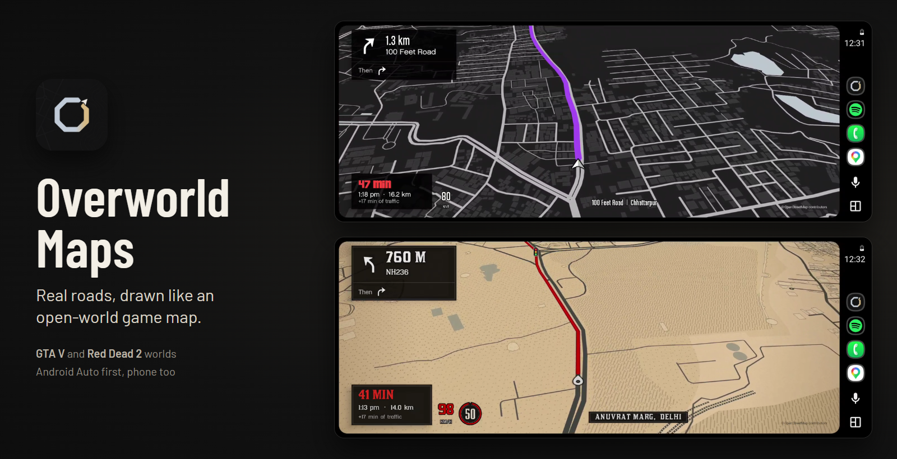
</p>

<p align="center">
  <strong>Turn-by-turn navigation on real roads, drawn like the map in GTA V, Red Dead Redemption 2 or GTA VI.</strong><br>
  Built for Android Auto on a car's wide screen, with the same worlds on the phone.
</p>

<p align="center">
  <a href="#get-it">Get it</a>
  &nbsp;·&nbsp;
  <a href="#screenshots">Screenshots</a>
  &nbsp;·&nbsp;
  <a href="#features">Features</a>
  &nbsp;·&nbsp;
  <a href="#how-it-works">How it works</a>
  &nbsp;·&nbsp;
  <a href="#build-it">Build it</a>
  &nbsp;·&nbsp;
  <a href="#put-it-in-the-car">Put it in the car</a>
</p>

<p align="center">
  
  
  
  
</p>

## Why Overworld Maps

Games have spent twenty years making maps people want to look at. Car navigation still draws grey lines on beige. Overworld Maps draws the real roads under your car in the style of a game's map and HUD: GTA V's near-black pause map with its purple waypoint route, Red Dead's parchment and ink with a red trail, or GTA VI's pale sat-nav minimap with raised buildings and a pink route.

It is a personal project, built first for one car: a Tata Curvv with a 10.25-inch 1920x720 HARMAN screen and wireless Android Auto. It has since been driven in a Tata Nexon and a Volkswagen Virtus GT too. The phone app covers everything else, down to a ride on the bike.

| World | Look | Status |
|---|---|---|
| **GTA V** | The pause map: near-black land, flat grey roads, ice-pale water, no labels, the game's shop blips, a flat waypoint-purple route, a scale bar and area name in the corner. The radar's gentle tilt while driving. GTA menus and HUD. | Ready |
| **Red Dead 2** | Parchment and ink: ink roads, dotted railways, pencil place names, hatched forest, paper grain, a red route. Seen from straight above, like the game's minimap. Red Dead menus and HUD. | Ready |
| **GTA VI** | The minimap from Rockstar's 2026 Extended Look: a steep 3D view close in, pale warm-grey ground, broad roads with lane dashes, raised and shaded buildings, flyovers standing over the roads below, grey-teal water, no names, and a pink route that fades in just ahead of the marker. It follows the sun: dim and warm at golden hour, violet slate at night. Rounded dark-glass HUD. | Ready |
| **Next** | Minecraft, Genshin Impact, Fortnite OG, Zelda: Breath of the Wild, Cyberpunk 2077. | Planned |

## Get it

**On the phone:** download the APK from the [latest release](https://github.com/TheAlgo7/overworld-maps/releases/latest) and open it (Android 10 or newer; allow installs from your browser or files app when asked). This build uses free stand-in fonts in place of the games' own (see [Game fonts and art](#game-fonts-and-art)) and takes live traffic from Google alone.

**In the car:** Android Auto only shows navigation apps installed from Google Play, so the car needs the Play copy. Overworld is in testing on Google Play: join the [Algothrim testers group](https://groups.google.com/g/algothrim-testers) with the Google account on your phone, then open [Overworld's Play testing page](https://play.google.com/apps/testing/com.thealgothrim.overworld) on the phone, tap **Become a tester** and install. Updates arrive as ordinary Play Store updates. The APK and the Play copy are signed differently, so uninstall one before installing the other.

## Screenshots

**In the car** (the Curvv's 1920x720 screen; Android Auto adds its own buttons at the right):

<table>
  <tr>
    <td align="center">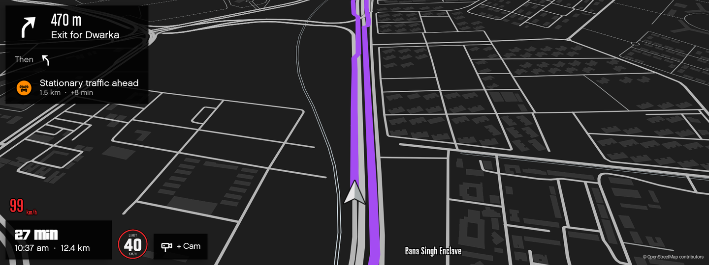<br><sub>GTA V: over the limit, the speed and the sign turn red</sub></td>
    <td align="center">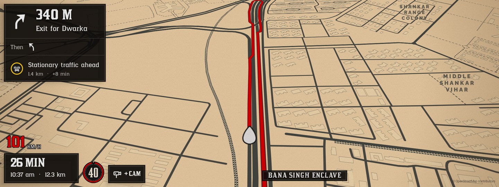<br><sub>Red Dead 2: the same drive in ink</sub></td>
  </tr>
  <tr>
    <td align="center">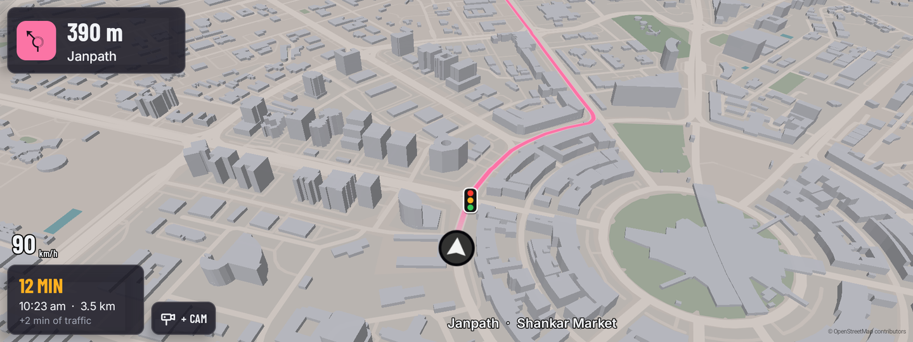<br><sub>GTA VI: raised buildings, a pink route</sub></td>
    <td align="center">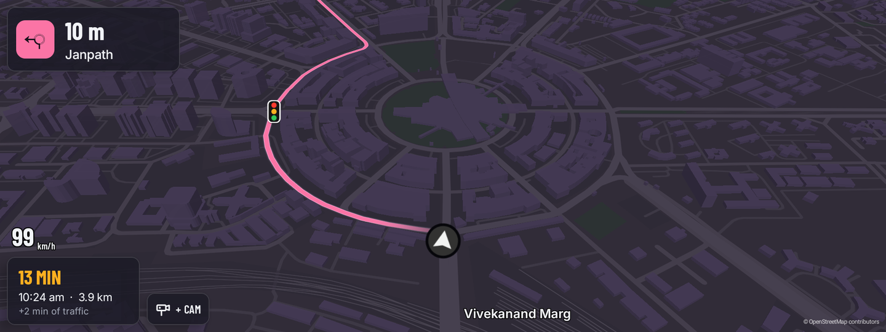<br><sub>GTA VI after dark: the map follows the sun</sub></td>
  </tr>
</table>

**On the phone:**

<table>
  <tr>
    <td align="center">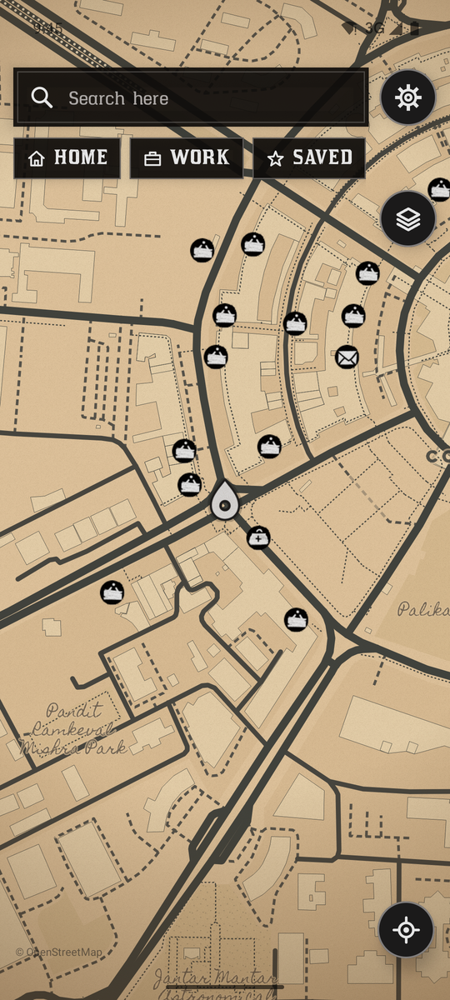<br><sub>The map, with blips</sub></td>
    <td align="center">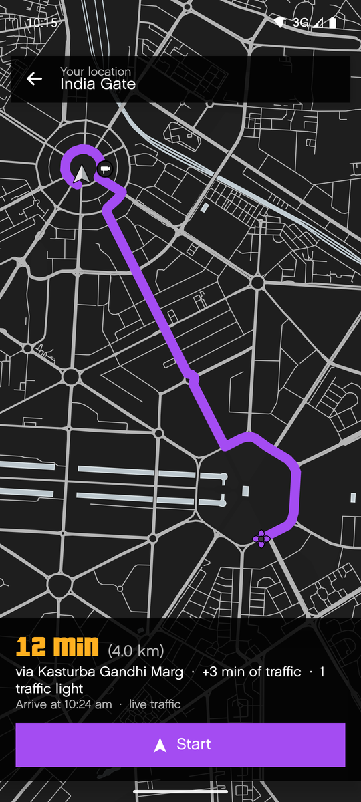<br><sub>Route preview, live traffic</sub></td>
    <td align="center">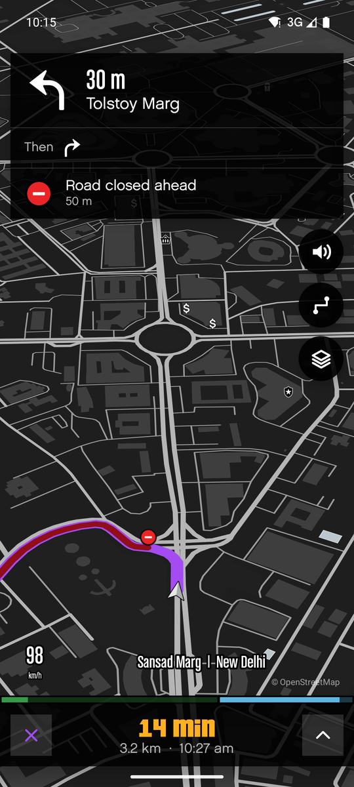<br><sub>Driving: GTA V</sub></td>
    <td align="center">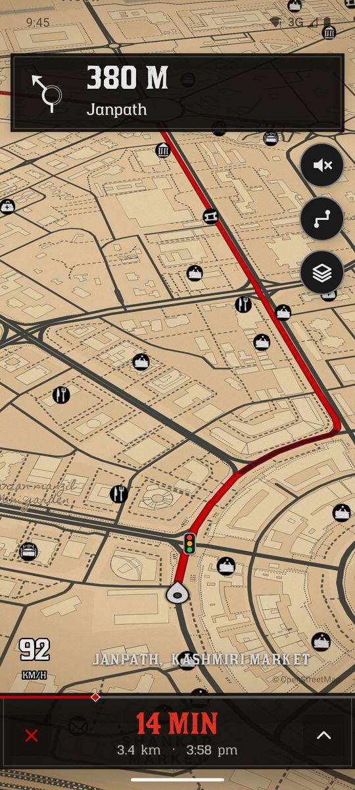<br><sub>Driving: Red Dead 2</sub></td>
    <td align="center">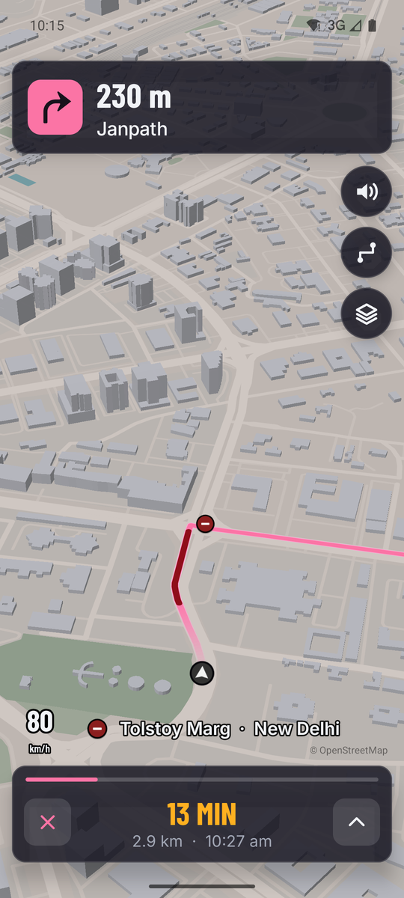<br><sub>Driving: GTA VI</sub></td>
    <td align="center">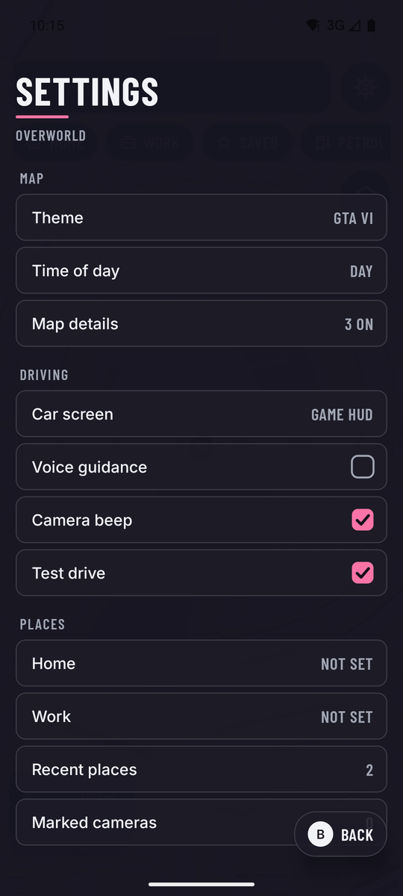<br><sub>Settings is the pause menu</sub></td>
  </tr>
</table>

## Features

- **The car screen comes first.** Our HUD owns the left of the Android Auto screen and Android Auto keeps the right: the turn card with "Then" and road alerts top-left, the time card bottom-left with the speedometer standing on it and the speed-limit sign beside it, the street name along the bottom. The route preview is a themed card with Start and Cancel drawn in the game's style.
- **Any car screen.** The HUD is drawn for the Curvv's wide screen and scales down to fit smaller head units and the map's half of a split screen (Spotify beside it), so nothing overlaps. Switching between full screen and split screen glides instead of jumping.
- **Map buttons in the game's style.** Sound, zoom and the route overview are round buttons drawn in each world's look, in place of Android Auto's grey ones. They appear with a touch and leave with Android Auto's own buttons, so the map stays clear while driving. Drag, pinch or zoom the map and a **re-centre** button stays until you tap it: your own marker in the route's colour, and the camera glides back onto the car in under half a second. Buttons show the moment a finger touches the screen.
- **A camera like each game's, zoomed like Google's.** Each world has its own tilt (steep 3D for GTA VI, gentle for GTA V, flat for Red Dead). The map pulls back on a fast straight road and comes in before a turn. Your marker sits low and right of centre, pointing straight up the road, and is drawn where the car is now, not a GPS fix behind.
- **Flyovers you drive under.** Bridges stand over the roads they cross with an edge and a shadow on the ground. The route runs under a flyover you pass beneath and over one you drive on, like the games' minimaps.
- **Settings in the car.** The theme, GTA VI's time of day, place icons, traffic on every road, 3D buildings, the game HUD, the camera beep and + Cam all switch from the car screen, so the phone can stay in its mount.
- **Your places on the map.** Home, Work and starred places stand on the map the way each game marks what's yours (a safehouse, a briefcase, a star), and a tap on one opens it.
- **Free drive.** With no trip the car map still follows you heading-up and glides between GPS fixes, with your speed, the area name and camera alerts, like Google Maps' free drive. Parked for a few minutes, "Where to?" comes back with Home and Work one tap away.
- **Steady GPS.** Fixes that jump further than the car could have driven are held back, so at a red light the marker stays put instead of wandering onto the crossing road, and under a flyover it carries on along the road for a few seconds instead of freezing. A real wrong turn still reroutes within seconds; a single stray fix never does. Driving the wrong way along the route (the other carriageway of a divided road, a few metres away) counts as a wrong turn too.
- **Says when GPS is gone.** No fix for a while shows "Location not found" instead of a frozen marker, and the speed hides rather than showing an old one.
- **Find places on the car screen.** Search (Android Auto's keyboard while parked) and **Nearby**: petrol and CNG, food, parking, toilets, hospitals and hotels, closest first.
- **Google's routes and places, the game's look.** Trips follow Google Maps' own route, with its traffic, closures and one-ways and its time to go, laid onto the game map. Where Google's line takes a U-turn gap the map data draws differently, the gap is bridged instead of the route being dropped, and a reroute never starts by turning the car around. The open routing service is asked at the same time, so a route shows in under two seconds even when Google is slow. Search asks Google alongside TomTom and OpenStreetMap, so small places only Google lists (a house, a small church) turn up. It also reads plus codes like `F5QR+3F New Delhi` and takes a place shared from Google Maps (Share > Overworld). One switch in Settings turns Google off and uses only open data.
- **The route behaves like the games'.** The road already driven disappears behind the marker, as on GTA V's radar and Red Dead's minimap; GTA VI's fades in just ahead of it. The markers are drawn small, the way the games draw their blips.
- **Traffic only where it matters.** Like Google's route line: amber where slow, red for jams, darkest where closed, and only on your route. Traffic on every road is one switch away in Layers, off by default.
- **Road alerts.** Traffic lights on the route, speed cameras ahead (every kind OpenStreetMap has, plus the ones you mark with **+ Cam** while driving, a car-screen button you turn on in Settings, and an optional beep), and accidents, road works and closures that run along the route (not side streets it crosses), with how much time the traffic adds.
- **Speed-limit signs for each world**, turning red at 5 km/h over, along with the speed.
- **GTA VI follows the sun.** Its map is pale by day, warm at golden hour and violet at night, worked out from where you are, or held at one in Settings. Its buildings stand up in 3D; a Layers switch lays them flat.
- **Google Maps layout, game look.** Search, Home, Work and Saved, a place sheet, a route preview, a Layers sheet with theme cards. Tap a shop, temple or petrol pump on the map and the camera flies to it with Directions and Save; tilt with two fingers; tap locate twice and the map turns with the phone. GTA's pause-map corner shows the area and the scale beside the locate button. Settings is the game's pause menu, in four groups (map, driving, places, about); anything that forgets a place asks for a second tap.
- **Navigation requests in the car.** When Android Auto hands Overworld a destination ("navigate to India Gate", or an address from a message), it drives there, by place name or by coordinates, even with a trip already running.
- **Made for Indian roads.** Metric, a 12-hour clock, and turn arrows for left-hand traffic: roundabouts circle clockwise and U-turns curl right.
- **Costs nothing to run.** OpenFreeMap tiles, public routing and search, Google's public web endpoints, and an optional free TomTom key for traffic.

## How it works

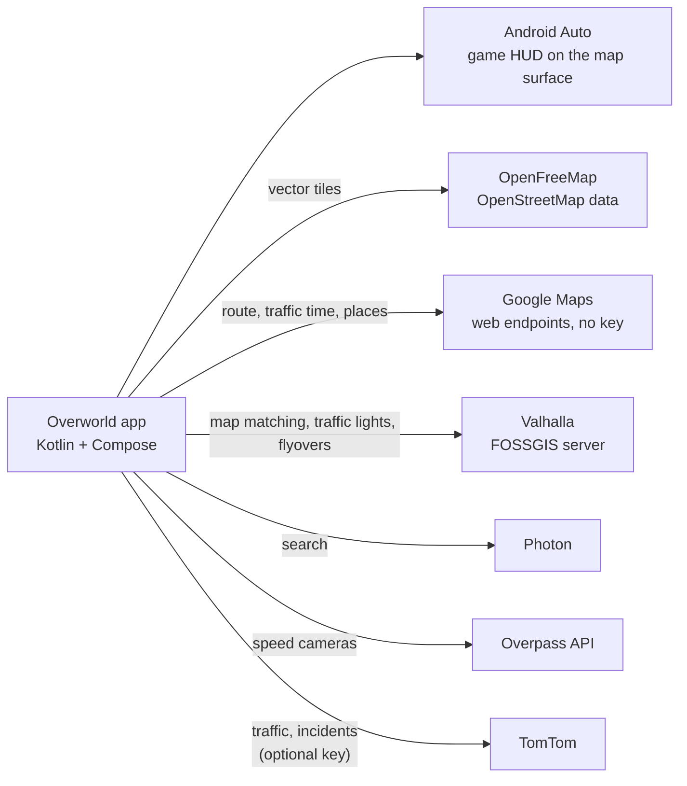

- **One theme source.** `prototype/themes.js` holds every palette and layer rule. `node tools/export-android.mjs` writes the app's MapLibre style JSON and `ThemeTokens.kt` from it, so the web prototype and the app can't drift apart.
- **Map:** MapLibre Native through MapLibre Compose, using the OpenGL build (the Vulkan build failed to compile its shaders on a Galaxy S24 Ultra, and only the background drew).
- **Navigation:** [Ferrostar](https://github.com/stadiamaps/ferrostar) 0.57 follows the route and reroutes. Routes come through our own route provider (`routing/OverworldRoutes.kt`): Google Maps' driving route, asked the way its website asks, then laid onto OpenStreetMap's roads by Valhalla's map matching (`trace_route`), so the turn instructions, lanes and speed limits are OpenStreetMap's while the road chosen is Google's. When Google can't help (stops on the way, a very long trip, a refusal, or a road OpenStreetMap doesn't have), Valhalla plans the route itself. The method is [Vela Maps'](https://github.com/PimpinPumpkin/Vela). India drives on the left and gets metric prompts.
- **Car:** a navigation `CarAppService`. The game HUD is drawn with Compose on the map surface in place of Android Auto's own cards, and taps on the drawn buttons are passed through to the app.
- **Traffic on our own line:** Google's jams come measured along its route, which is the route we drive. Without Google, TomTom rebuilds our route from supporting points and returns its traffic sections, so the colours sit on the line we draw either way.
- **Flyovers:** the styles draw bridges above other roads by OpenStreetMap's level with a shadow below, and mark where they start (`bridges-start`). The app draws the route under that mark, and draws again on top the stretches Valhalla's `trace_attributes` says are on a bridge.

### Road info

| What | Where it comes from | Needs |
|---|---|---|
| Traffic lights and flyovers on the route | Valhalla `trace_attributes` on the same server that routes (OpenStreetMap `highway=traffic_signals` and `bridge=yes`), about a second per route | nothing |
| Speed cameras ahead | OpenStreetMap through Overpass, in small boxes along the route (Overpass is often busy; cameras simply arrive later) | nothing |
| Traffic on your route (amber slow, red jams, darkest where closed) | Google Maps' jams on its route; otherwise TomTom routing rebuilt along our own route (`supportingPoints`, `sectionType=traffic`) | nothing, or TomTom key |
| Traffic on every road (off unless turned on in Layers): highways from city zoom, arterials from 13, streets from 14.5, only roads slower than usual | TomTom traffic-flow vector tiles, coloured per theme | TomTom key |
| Accidents, road works, closures, lane closures, flooding along the route, and stationary traffic ahead | TomTom incident details, refreshed every 2.5 minutes while driving | TomTom key |
| Time to go with traffic, and "+21 min of traffic" | Google Maps (its time with today's traffic against its usual time); otherwise the same TomTom request as the route traffic (travel time minus empty-road time) | nothing, or TomTom key |

**TomTom key (free, no card):** sign up at developer.tomtom.com, copy the default API key, add `tomtomKey=<key>` to `android/local.properties` (gitignored), rebuild. The free tier gives 2,500 non-tile and 50,000 tile requests a day, far more than one driver uses. Without a key the app works as before and Layers shows those rows as off.

## Game fonts and art

The games' own fonts (Pricedown, Chalet, RDR Lino, RDR Catalogue, Hapna Slab Serif) and Rockstar's map blips are commercial or Rockstar Games property, so they are **not in this repository**. The app loads them from `android/app/src/local/` when that folder exists (it's gitignored) and otherwise uses free stand-ins with similar shapes: Barlow, Barlow Condensed, Passion One and IM FELL English, with redrawn vector icons. A clone builds and runs; it just looks a little less like the games. The screenshots above come from the author's build, which has them. GTA VI's interface is set in Inter and Barlow Condensed, both open fonts, so it looks the same in every build.

The speed-limit signs, the player markers and the app icon are the author's own artwork.

## Build it

You need JDK 21 and the Android SDK.

```powershell
powershell -File tools/build-install.ps1          # build the debug APK and install it on the connected phone or emulator
```

Or by hand from PowerShell: `cd android; .\gradlew.bat :app:assembleDebug`. Add `-Ppublic` to a release build to leave out the game fonts and the TomTom key even when they're on your machine; that's how the APK on the releases page is made. Debug builds are their own app, `com.thealgothrim.overworld.debug` ("Overworld debug"), so they install next to the Play copy instead of over it. Don't call `gradlew.bat` from Git Bash when the path has a space in it: it fails without an obvious error and the old APK stays in place.

After changing a theme in `prototype/themes.js`, run `node tools/export-android.mjs`, then rebuild.


### On the phone

1. Settings > About phone > Software information > tap **Build number** 7 times, then turn on Developer options > **USB debugging**.
2. Plug into the computer and accept the prompt.
3. `adb install -r android/app/build/outputs/apk/debug/app-debug.apk`

The phone app works fully like this. Turn on **Test drive** in Settings to simulate a trip without driving.

### Android Auto on a laptop (no car needed)

1. Phone: Settings > Connected devices > **Android Auto** > tap **Version** 10 times to unlock developer mode.
2. Android Auto's ⋮ menu > **Developer settings** > turn on **Unknown sources**.
3. Back on the **main** Android Auto page, ⋮ menu > **Start head unit server**.
4. Phone on USB. Run the Desktop Head Unit from a console window (it quits if its console has no input):
   ```bat
   adb forward tcp:5277 tcp:5277
   cd /d "%LOCALAPPDATA%\Android\Sdk\extras\google\auto" && desktop-head-unit.exe -c config\tata_curvv.ini
   ```
   Copy `tools/dhu/tata_curvv.ini` (1920x720, right-hand drive) into the SDK's `extras\google\auto\config` first.
5. Overworld is in the Android Auto app drawer. Pick a destination on the phone.

If the head unit sits on "Waiting for phone", stop and start the head unit server, then relaunch it.

**Test drives from the laptop** (debug builds, works with the phone locked):

```bat
adb shell am broadcast -n com.thealgothrim.overworld.debug/com.thealgothrim.overworld.DebugDriveReceiver -a com.thealgothrim.overworld.DEBUG_DRIVE --es theme gta5 --ef lat 28.6129 --ef lng 77.2295 --es name "India%sGate"
adb shell am broadcast -n com.thealgothrim.overworld.debug/com.thealgothrim.overworld.DebugDriveReceiver -a com.thealgothrim.overworld.DEBUG_STOP
```

The drive starts where the phone is. Add `--ef from_lat 28.6315 --ef from_lng 77.2167` to start somewhere else, here on Connaught Place's Outer Circle, a good test for roundabouts. `--es query "India%sGate"` drives to a place by name, the way a request from Android Auto arrives, and `--ez test false` makes it a real trip on the phone's GPS. `-a com.thealgothrim.overworld.DEBUG_STATE` logs what the app holds (trip, simulator, route extras, voice) under the `DebugDrive` tag.

**Tests** (`android/app/src/androidTest`, need a phone or emulator with internet): real Delhi and Chandigarh routes run through Android Auto's builders step by step, navigation requests in every link form, trips stopped as they start, search and Nearby on the car screen, and the car screen itself. `.\gradlew.bat :app:testDebugUnitTest` checks plus codes, typed coordinates, Google Maps links, the sun times behind GTA VI's day and night, the camera's zoom, tilt and marker lead, and reading Google's saved route and search answers, without a device. Run them on an emulator, since `connectedDebugAndroidTest` uninstalls the app afterwards. Put the emulator in Delhi first (`adb emu geo fix 77.2167 28.6315`); by default it thinks it's in California. Then install both APKs from `assembleDebug assembleDebugAndroidTest` and run `adb shell am instrument -w com.thealgothrim.overworld.debug.test/androidx.test.runner.AndroidJUnitRunner`.

Map icons and labels don't draw on the emulator's default software GPU. Start it on the computer's GPU: `emulator -avd <name> -gpu host`.

To check a world's car screen without a head unit, debug builds have `CarPreviewActivity`: the car map and HUD in a plain window. Set an emulator to the Curvv's screen (`adb shell wm size 1920x720` and `adb shell wm density 200`), open it with `adb shell am start -n com.thealgothrim.overworld.debug/com.thealgothrim.overworld.CarPreviewActivity`, and start a test drive as above (`--es time night` holds GTA VI at night).

## Put it in the car

Android Auto won't show a sideloaded navigation app in a real car ([Google's testing docs](https://developer.android.com/training/cars/testing)). It has to come from Google Play. Play's **internal testing** track skips the review and reaches up to 100 testers within minutes, which is the quickest way into your own car:

1. Create a Google Play Console developer account (USD 25 once, plus an identity check), then **Create app** with the package name `com.thealgothrim.overworld`.
2. Make an upload key (`keytool -genkeypair -keystore overworld-upload.jks -alias upload -keyalg RSA -keysize 4096 -validity 12000`) and put `uploadStoreFile`, `uploadStorePassword`, `uploadKeyAlias` and `uploadKeyPassword` in `android/local.properties`. Keep the key out of the repo. Play re-signs the app with its own key, and a lost upload key can be reset in Play Console.
3. Build the release bundle: `.\gradlew.bat :app:bundleRelease` (`android/app/build/outputs/bundle/release/app-release.aab`). Play's tracks refuse debug builds, and a bundle rather than an APK because the APK carries the map engine for four kinds of phone chip; from the bundle, Play sends each phone only its own.
4. Play Console > Test and release > Testing > **Internal testing**: under Testers, make an email list with your Google account. Under Releases, **Create new release**, let Google manage the app signing key, upload the bundle and roll it out.
5. Open the testers' opt-in link on the phone, accept, and install from Play. Overworld then appears in the car's Android Auto launcher. Later versions arrive as ordinary Play Store updates.

Internal app sharing (a link per upload, debug builds allowed) only works once the app has been published on a track, so it can't be the first step.

To reach more people, **closed testing** takes a Google Group as its tester list, so anyone who joins the group can install. It needs the store listing, content rating, data safety form and privacy policy filled in, and goes through Play's review (for Android Auto, the car-quality part of the review only warns on this track). A personal developer account then needs 12 testers opted in for 14 days in a row before it can apply for production; open testing unlocks with production ([Play's rules](https://support.google.com/googleplay/android-developer/answer/14151465), [car app distribution](https://developer.android.com/training/cars/distribute)).

## Project structure

```text
android/              the app (Kotlin, Jetpack Compose, Android Auto)
  app/src/main/       code, map styles, sprites, glyphs, speed-limit signs, player markers
  app/src/local/      game fonts and blips for personal builds (gitignored, optional)
prototype/            web preview of the themes on a recorded Delhi drive; themes.js is the theme source
tools/                style export, sprite, glyph, icon, sign and marker builders, build script, DHU preset
docs/readme/          the images on this page (tools/readme_hero.py draws the banner)
licenses/             licence texts for the bundled fonts
```

| Tool | What it does |
|---|---|
| `tools/export-android.mjs` | Writes the app's style files and `ThemeTokens.kt` from `themes.js` |
| `tools/make_sprite.py` | Builds Red Dead's hatch and stipple patterns and the map blips |
| `tools/make_glyphs.py` | Builds Red Dead's map-label fonts as MapLibre SDF glyphs |
| `tools/make_icon.py` | Builds the adaptive app icon from the artwork in `tools/icon/` |
| `tools/make_limit_signs.py` | Cuts the speed-limit sign sheets in `tools/signs/` into app drawables |
| `tools/make_pucks.py` | Builds the player markers from the drawings in `tools/blips/`, centred and never stretched |
| `tools/build-install.ps1` | Builds the debug APK and installs it |
| `tools/make_route.py` | Re-records the prototype's demo route |

## Known limits

- Driven in a Tata Curvv, a Tata Nexon and a Volkswagen Virtus GT over Android Auto and used on a Galaxy S24 Ultra; tested on the Desktop Head Unit at the screen sizes of India's popular cars (1920x720, 10.1- and 9-inch 1280x720, 7-inch 800x480) and on an emulator.
- Google's route, traffic and search come from the web endpoints its own website uses. They aren't a published API and can change or refuse without warning; the app then falls back to the open services on its own.
- The public routing and search servers are fair-use: fine for one driver, not for a public app with many users.
- OpenStreetMap knows few of Delhi's speed cameras (about 9 speed cameras and 40 enforcement cameras in the NCR core). Radarbot's list is its own and can't be used, so cameras you mark fill the gaps on your roads.
- With Google turned off, small places only Google lists (a house, a small church) aren't found. Share them from Google Maps, or type their plus code.
- Real 3D cities (Apple's Flyover, Google's photorealistic tiles) aren't available: Apple has no Flyover city in India, and photorealistic tiles need a paid key and a different map engine. The buildings are OpenStreetMap's footprints and heights.
- GTA V and GTA VI hide map labels, like the games' maps. Red Dead's label glyphs cover Latin scripts only.
- No offline maps yet (OpenFreeMap has no India extract download; Protomaps PMTiles would be the way).
- Android refuses the background location service if a trip starts while the app isn't on screen. The app then keeps navigating while the phone or car screen shows it, instead of crashing.
- Contour lines like Red Dead's paper map aren't possible from OpenFreeMap, which has no contour layer.

## Credits

Map data © OpenStreetMap contributors (ODbL). Tiles: OpenFreeMap, OpenMapTiles schema. Routes, traffic and places: Google Maps, asked the way [Vela Maps](https://github.com/PimpinPumpkin/Vela) (GPL-3.0) asks it. Map matching, routing and traffic lights: Valhalla on the FOSSGIS server. Speed cameras: Overpass API. Live traffic (optional): TomTom. Search: Photon by komoot. Navigation: Ferrostar by Stadia Maps (BSD 3-Clause). Turn arrows: Mapbox Directions Icons (CC0). Fonts: Barlow, Barlow Condensed, Inter, IM FELL English, Passion One, Crimson Text, Merriweather, Raleway (SIL Open Font License) and Homemade Apple (Apache 2.0). Details in `THIRD_PARTY_NOTICES.txt` and `licenses/`.

Overworld Maps is a fan project. It is not affiliated with or endorsed by Rockstar Games or Take-Two Interactive. Grand Theft Auto and Red Dead Redemption are their trademarks, named here only to say which game each look is modelled on.

## Licence

Copyright © 2026 Gaurav Kumar, [The Algothrim](https://thealgothrim.com). All rights reserved.

The code is public to read and learn from. It is not licensed for reuse. Third-party code, fonts and data keep their own licences.
