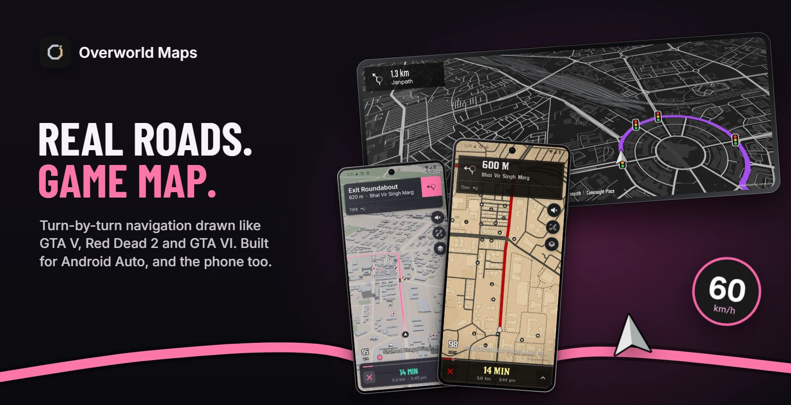
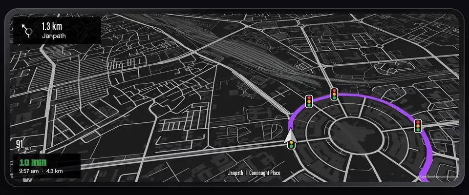
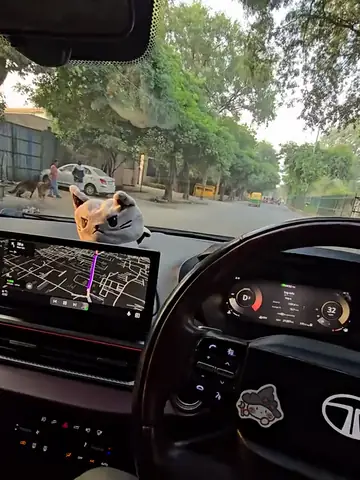
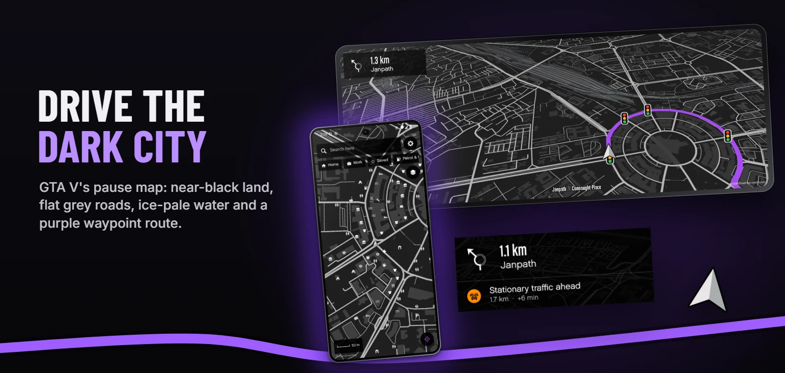
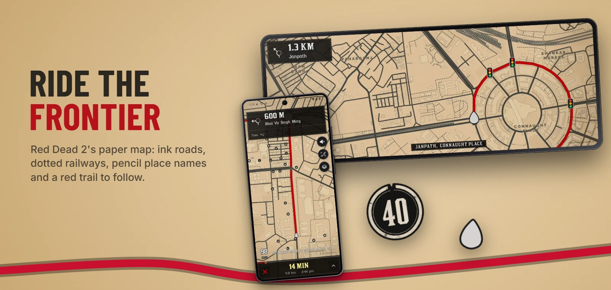
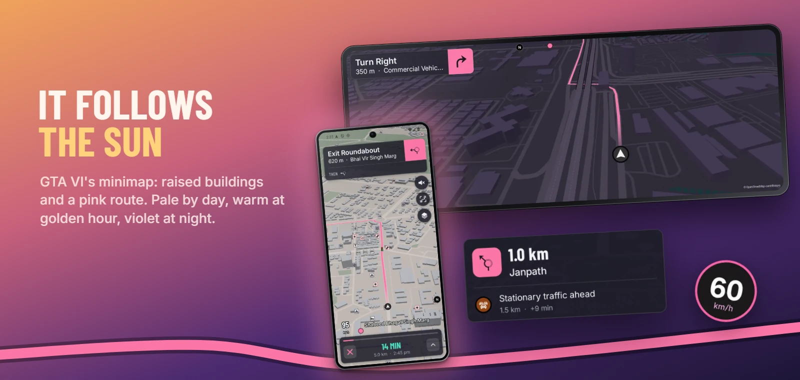
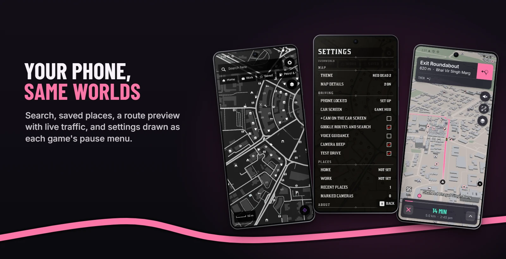
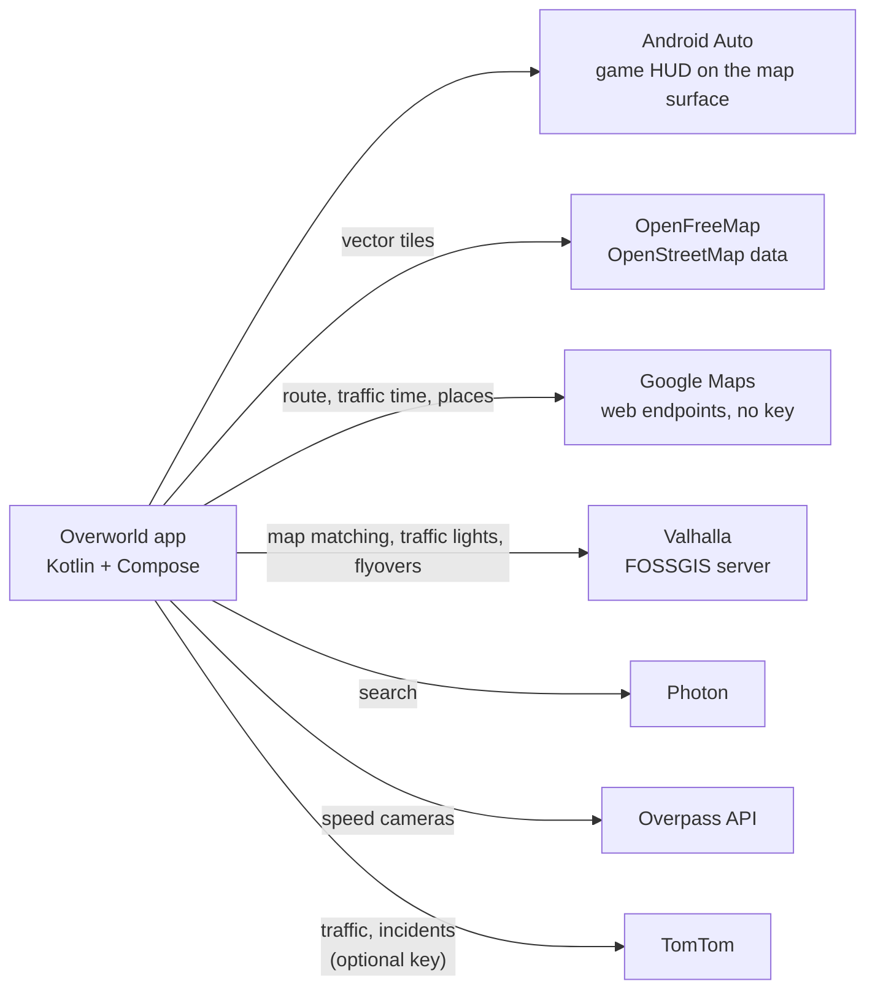

<p align="center">
  <picture>
    <source media="(max-width: 600px)" srcset="docs/readme/hero-mobile.webp">
    
  </picture>
</p>

<p align="center">
  <strong>Turn-by-turn navigation on real roads, drawn like the map in GTA V, Red Dead Redemption 2 or GTA VI.</strong><br>
  Built for Android Auto on a car's wide screen, with the same worlds on the phone.
</p>

<p align="center">
  <a href="#get-it"></a>
  <a href="https://github.com/TheAlgo7/overworld-maps/releases/latest"></a>
  <a href="https://overworld.thealgothrim.com"></a>
</p>

<p align="center">
  <a href="#get-it">Get it</a> ·
  <a href="#three-worlds">Three worlds</a> ·
  <a href="#features">Features</a> ·
  <a href="#how-it-works">How it works</a> ·
  <a href="#build-it">Build it</a> ·
  <a href="#known-limits">Known limits</a>
</p>

<p align="center">
  
  <br>
  <sub>One drive round Connaught Place, New Delhi, in all three worlds, on the car's 1920x720 screen.</sub>
</p>

## Why Overworld Maps

Games have spent twenty years making maps people want to look at. Car navigation still draws grey lines on beige. Overworld Maps draws the real roads under the car in the style of a game's map and HUD, and drives you there turn by turn, with Google's routes and live traffic underneath.



It was built first for one car: a Tata Curvv with a 10.25-inch 1920x720 HARMAN screen and wireless Android Auto. It has since been driven in a Tata Nexon and a Volkswagen Virtus GT too, and tested at the screen sizes of India's popular cars, down to a 7-inch 800x480 head unit. The phone app covers everything else, down to a ride on the bike.

No account, no ads, and nothing to pay: the maps, routing and search are free services, and live traffic comes from Google.

<br clear="right">

## Get it

**In the car:** Android Auto only lists navigation apps installed from Google Play, so the car needs the Play copy. Overworld is in closed testing on Google Play (India for now):

1. Join the [Algothrim testers group](https://groups.google.com/g/algothrim-testers) with the Gmail account on your phone.
2. Open the [Play testing page](https://play.google.com/apps/testing/com.thealgothrim.overworld), tap **Become a tester** and install.

Updates then arrive as ordinary Play Store updates.

**On the phone:** download the APK from the [latest release](https://github.com/TheAlgo7/overworld-maps/releases/latest) and open it (Android 10 or newer; allow installs from your browser or files app when asked). **The APK is for the phone only: it doesn't show up in Android Auto.** It uses free stand-in fonts in place of the games' own (see [Game fonts and art](#game-fonts-and-art)) and takes live traffic from Google alone.

The APK and the Play copy are signed differently, so uninstall one before installing the other.

## Three worlds

<picture>
  <source media="(max-width: 600px)" srcset="docs/readme/world-gta5-mobile.webp">
  
</picture>

**GTA V.** The pause map: near-black land, flat grey roads, ice-pale water, no labels, the game's shop blips, a flat waypoint-purple route, a scale bar and the area name in the corner. The radar's gentle tilt while driving. GTA menus and HUD.

<picture>
  <source media="(max-width: 600px)" srcset="docs/readme/world-rdr2-mobile.webp">
  
</picture>

**Red Dead 2.** Parchment and ink: ink roads, dotted railways, pencil place names, hatched forest, paper grain and a red route. Seen from straight above, like the game's minimap. Red Dead menus and HUD.

<picture>
  <source media="(max-width: 600px)" srcset="docs/readme/world-gta6-mobile.webp">
  
</picture>

**GTA VI.** The minimap from Rockstar's 2026 Extended Look: a steep 3D view close in, pale warm-grey ground, broad roads with lane dashes, raised and shaded buildings, flyovers standing over the roads below, grey-teal water, no names, and a pink route that fades in just ahead of the marker. It follows the sun: pale by day, warm at golden hour, violet slate at night. Rounded dark-glass HUD.

<picture>
  <source media="(max-width: 600px)" srcset="docs/readme/phone-mobile.webp">
  
</picture>

**On the phone,** the same three worlds with Google Maps' layout: search, Home, Work and Saved, a place sheet, a route preview with live traffic, and Settings drawn as the game's pause menu.

## Features

- **The car screen comes first.** The HUD owns the left of the Android Auto screen and Android Auto keeps the right: the turn card with "Then" and road alerts, the time card with the speedometer and the speed-limit sign, the street name along the bottom. It scales to every head unit and to split screen beside Spotify.
- **Google's routes, the game's look.** Trips follow Google Maps' own route, with its traffic, closures and time to go, laid onto the game map. One switch turns Google off and uses only open data.
- **Every light, every camera.** Traffic lights on the route, speed cameras ahead, accidents, road works and closures along the way, and speed-limit signs for each world that turn red at 5 km/h over.
- **Flyovers you drive under.** Bridges stand over the roads they cross, and the route runs under a flyover you pass beneath and over one you drive on.
- **The phone is a remote for the car.** With Android Auto on, the phone shows the trip, the route preview, search and every car-screen setting instead of a second map.
- **Made for Indian roads.** Metric, a 12-hour clock, and turn arrows for left-hand traffic: roundabouts circle clockwise and U-turns curl right.

<details>
<summary><strong>Everything else it does</strong></summary>

### On the car screen

- **Any car screen.** The HUD is drawn for the Curvv's wide screen and scales down to fit smaller head units and the map's half of a split screen, so nothing overlaps. Switching between full screen and split screen glides instead of jumping.
- **Map buttons in the game's style.** Sound, zoom and the route overview are round buttons drawn in each world's look, in place of Android Auto's grey ones. They appear with a touch and leave with Android Auto's own buttons, so the map stays clear while driving. Dragging follows the finger, a flick glides on and a pinch zooms where your fingers are. Drag, pinch or zoom the map and a **re-centre** button stays until you tap it: your own marker in the route's colour, and the camera glides back onto the car in under half a second.
- **A camera like each game's, zoomed like Google's.** Each world has its own tilt (steep 3D for GTA VI, gentle for GTA V, flat for Red Dead). The map pulls back on a fast straight road and comes in before a turn. Your marker sits low and right of centre, pointing straight up the road, and is drawn where the car is now, not a GPS fix behind. Between fixes the camera and the marker keep moving along the route instead of stopping to wait for the next one.
- **Menus in the game's look.** Everything of Overworld's sits in one column on the left, like Google's one card. Settings, Saved, Nearby and search results open as panels in the world's own style over the live map, not as Android Auto's plain full-screen lists (those are one switch away). While driving, Nearby, Settings and End come up with a touch and leave with Android Auto's own buttons.
- **Settings in the car, kept apart from the phone's.** The theme, GTA VI's time of day, place icons, traffic, 3D buildings, the game HUD, the camera beep and + Cam all switch from the car screen, and the car remembers its own: GTA VI in the car while the phone stays on GTA V. Each switch lights up in the world's colour while it's on, and a drag on the screen scrolls the list, not the map behind it.
- **Day and night with the car.** In the car, GTA VI's Auto follows what the car says (its light sensor or headlights), from the main screen; the instrument cluster, which can stay dark all day, no longer decides it.
- **The map between the dials.** In cars with an instrument cluster display (the Curvv's "map view"), the route and the arrow show there too, low on the screen so most of it is road ahead.
- **Free drive.** With no trip the car map still follows you heading-up and glides between GPS fixes, with your speed, the area name and camera alerts, like Google Maps' free drive. Parked for a few minutes, a compact "Where to?" card comes back with search, Home, Work and your last places, each one tap away.
- **Find places on the car screen.** Search (Android Auto's keyboard while parked; the results then open over the map) and **Nearby**: petrol and CNG, food, parking, toilets, hospitals and hotels, closest first. On a trip, a pick becomes a stop on the way.
- **Navigation requests in the car.** When Android Auto hands Overworld a destination ("navigate to India Gate", or an address from a message), it drives there, by place name or by coordinates, even with a trip already running.

### Routes, traffic and GPS

- **Google's routes and places.** Where Google's line takes a U-turn gap the map data draws differently, the gap is bridged instead of the route being dropped, and a reroute never starts by turning the car around. The open routing service is asked at the same time, so a route shows in under two seconds even when Google is slow. Search asks Google alongside TomTom and OpenStreetMap, so small places only Google lists (a house, a small church) turn up. It also reads plus codes like `F5QR+3F New Delhi` and takes a place shared from Google Maps (Share > Overworld).
- **The route behaves like the games'.** The road already driven disappears behind the marker, as on GTA V's radar and Red Dead's minimap; GTA VI's fades in just ahead of it. The markers are drawn small, the way the games draw their blips.
- **Traffic only where it matters.** Like Google's route line: amber where slow, red for jams, darkest where closed, and only on your route. Traffic on every road is one switch away in Layers, off by default.
- **Road alerts.** Speed cameras include every kind OpenStreetMap has, plus the ones you mark with **+ Cam** while driving (a car-screen button you turn on in Settings, with an optional beep). Accidents, road works and closures count only when they run along the route (not side streets it crosses), with how much time the traffic adds.
- **Take the flyover, or don't.** Where the route goes up a flyover or down an underpass and a road stays on the ground beside it, or keeps to the service road while a flyover rises beside it, the turn card says so at the split: "Bear left" with "Don't take the flyover" under it, or "In 300 m, take the flyover" where the route has no turn of its own. It's worked out from the map's own roads along the route, the same OpenStreetMap data the map draws.
- **Knows which level you're on.** If you end up on the flyover while the route takes the service road beside it (or the other way round), the marker moves to the road you're really on and the route starts again from it within a few seconds, helped by the phone's barometer, which feels the climb onto the deck. Flyovers and service roads are often 10 to 30 m apart, too close for the usual off-route check.
- **Steady GPS.** Fixes that jump further than the car could have driven are held back, so at a red light the marker stays put instead of wandering onto the crossing road, and under a flyover it carries on along the road for a few seconds instead of freezing. A real wrong turn still reroutes within seconds; a single stray fix never does. Driving the wrong way along the route (the other carriageway of a divided road, a few metres away) counts as a wrong turn too.
- **Says when GPS is gone.** No fix for a while shows "No GPS signal" instead of a frozen marker, and the speed hides rather than showing an old one. With the phone's location switched off, the car screen says "No location: turn on location when it's safe to do so", and the phone offers the switch in a small line under the search bar.

### On the phone

- **Google Maps layout, game look.** Tap a shop, temple or petrol pump on the map and the camera flies to it with Directions and Save; tilt with two fingers; tap locate twice and the map turns with the phone. GTA's pause-map corner shows the area and the scale beside the locate button. Settings is the game's pause menu with seven tabs across the top (Display, Navigation, Vehicle, Privacy, Offline, Alerts, About), each on one screen: Display opens first with the three worlds as pictures, one tap to switch, and every switch reads On or Off. Anything that forgets a place asks for a second tap.
- **Your places on the map.** Home, Work and starred places stand on the map the way each game marks what's yours (a safehouse, a briefcase, a star), and a tap on one opens it.
- **You: saved places, Timeline and history.** The player-marker button beside Settings opens You, a game menu with three tabs. **Saved** holds Home, Work, your parked car, lists (Favourites, Want to go, Travel plans, Starred and your own, each with one of the world's icons), places with your own names and notes, and saved trips that start in one tap. **Timeline** shows where you stopped and the drives between them: a day at a time, a month at a glance, your most visited places and cities, and trips away from home, and any day can be drawn on the map. **History** keeps your searches, the places you looked at and your directions, each one removable. All of it stays on the phone; Timeline can be switched off or cleared in Settings, Privacy.
- **Car, bike or walk.** Directions show the time by car, by motorbike and on foot side by side, and one tap switches the route. Walking routes keep to footpaths at your walking pace, and the speed badge hides on foot.
- **Route options like Google's.** Avoid tolls, highways or ferries, take the fuel-efficient route, pick kilometres or miles, set the voice's volume, hide the speed limit or the speedometer, or keep the map north up. The engine type (petrol, diesel, CNG, hybrid, electric) decides what Nearby offers: charging points for an EV, CNG stations for CNG.
- **Where you parked.** Save the car's spot when a trip ends, with a note and a time limit. A reminder comes 10 minutes before the time runs out, and the car stands on the map with a walk back to it.
- **Offline maps.** Frame an area, see its size in MB, and download it for streets without signal; the map draws there with no connection. Areas update on Wi-Fi and can be renamed or deleted. Routes and search still need the internet.
- **Notifications you choose.** Parking reminders, a monthly Timeline recap and a finished offline download, each with its own switch in Settings, Alerts, along with the dot that says a newer Overworld is out.
- **The phone as the car's remote.** The trip (turn, time left, End, voice), the route preview with Start, search and shortcuts, and every car-screen setting, in the car's theme. "Phone map" brings the map back for a passenger.
- **GTA VI follows the sun.** Its map is worked out from where you are, or held at one time of day in Settings. Its buildings stand up in 3D; a Layers switch lays them flat.
- **Costs nothing to run.** OpenFreeMap tiles, public routing and search, Google's public web endpoints, and an optional free TomTom key for traffic.
- **Report a problem.** Settings, About, Report a problem opens your email app with what the app saw: your settings, its drive diary, how smoothly each screen drew, and where you drove in the last few hours (take that file off if you'd rather not share it). Something wrong mid-drive? "Mark this moment" in the car's Settings notes it for the report. Nothing is sent until you press Send.

</details>

## How it works



- **One theme source.** `prototype/themes.js` holds every palette and layer rule. `node tools/export-android.mjs` writes the app's MapLibre style JSON and `ThemeTokens.kt` from it, so the web prototype and the app can't drift apart.
- **Map:** MapLibre Native through MapLibre Compose, using the OpenGL build (the Vulkan build failed to compile its shaders on a Galaxy S24 Ultra, and only the background drew).
- **Navigation:** [Ferrostar](https://github.com/stadiamaps/ferrostar) 0.57 follows the route and reroutes. Routes come through our own route provider (`routing/OverworldRoutes.kt`): Google Maps' driving route, asked the way its website asks, then laid onto OpenStreetMap's roads by Valhalla's map matching (`trace_route`), so the turn instructions, lanes and speed limits are OpenStreetMap's while the road chosen is Google's. When Google can't help (stops on the way, a very long trip, a refusal, or a road OpenStreetMap doesn't have), Valhalla plans the route itself. The method is [Vela Maps'](https://github.com/PimpinPumpkin/Vela). India drives on the left and gets metric prompts.
- **Car:** a navigation `CarAppService`. The game HUD is drawn with Compose on the map surface in place of Android Auto's own cards, and taps on the drawn buttons are passed through to the app.
- **Traffic on our own line:** Google's jams come measured along its route, which is the route we drive. Without Google, TomTom rebuilds our route from supporting points and returns its traffic sections, so the colours sit on the line we draw either way.
- **Flyovers:** the styles draw bridges above other roads by OpenStreetMap's level with a shadow below, and mark where they start (`bridges-start`). The app draws the route under that mark, and draws again on top the stretches Valhalla's `trace_attributes` says are on a bridge.
- **Flyover calls and the level check:** `routing/VectorTiles.kt` reads OpenFreeMap's own zoom-14 tiles along the route (a small vector-tile reader, roads only) and `routing/RoadLevels.kt` walks the route every 5 m: which stretches are on a bridge or in a tunnel, which flyovers or underpasses run beside it, and where each splits from the route, found by following the other road back until the two meet. `location/LevelCheck.kt` compares each GPS fix with the route and with those roads beside it, with the barometer's climb or drop as a second witness, and starts the reroute on the road the car is on.

<details>
<summary><strong>Where each piece of road info comes from</strong></summary>

| What | Where it comes from | Needs |
|---|---|---|
| Traffic lights and flyovers on the route | Valhalla `trace_attributes` on the same server that routes (OpenStreetMap `highway=traffic_signals` and `bridge=yes`), about a second per route | nothing |
| Speed cameras ahead | OpenStreetMap through Overpass, in small boxes along the route (Overpass is often busy; cameras simply arrive later) | nothing |
| Traffic on your route (amber slow, red jams, darkest where closed) | Google Maps' jams on its route; otherwise TomTom routing rebuilt along our own route (`supportingPoints`, `sectionType=traffic`) | nothing, or TomTom key |
| Traffic on every road (off unless turned on in Layers): highways from city zoom, arterials from 13, streets from 14.5, only roads slower than usual | TomTom traffic-flow vector tiles, coloured per theme | TomTom key |
| Accidents, road works, closures, lane closures, flooding along the route, and stationary traffic ahead | TomTom incident details, refreshed every 2.5 minutes while driving | TomTom key |
| Time to go with traffic, and "+21 min of traffic" | Google Maps (its time with today's traffic against its usual time); otherwise the same TomTom request as the route traffic (travel time minus empty-road time) | nothing, or TomTom key |

**TomTom key (free, no card):** sign up at developer.tomtom.com, copy the default API key, add `tomtomKey=<key>` to `android/local.properties` (gitignored), rebuild. The free tier gives 2,500 non-tile and 50,000 tile requests a day, far more than one driver uses. Without a key the app works as before and Layers shows those rows as off.

</details>

## Game fonts and art

The games' own fonts (Pricedown, Chalet, RDR Lino, RDR Catalogue, Hapna Slab Serif) and Rockstar's map blips are commercial or Rockstar Games property, so they are **not in this repository**. The app loads them from `android/app/src/local/` when that folder exists (it's gitignored) and otherwise uses free stand-ins with similar shapes: Barlow, Barlow Condensed, Passion One and IM FELL English, with redrawn vector icons. A clone builds and runs; it just looks a little less like the games. The pictures on this page come from the author's build, which has them. GTA VI's interface is set in Inter and Barlow Condensed, both open fonts, so it looks the same in every build.

The speed-limit signs, the player markers and the app icon are the author's own artwork.

## Build it

You need JDK 21 and the Android SDK.

```powershell
powershell -File tools/build-install.ps1          # build the debug APK and install it on the connected phone or emulator
```

Or by hand from PowerShell: `cd android; .\gradlew.bat :app:assembleDebug`. Add `-Ppublic` to a release build to leave out the game fonts and the TomTom key even when they're on your machine; that's how the APK on the releases page is made. Debug builds are their own app, `com.thealgothrim.overworld.debug` ("Overworld debug"), so they install next to the Play copy instead of over it. Don't call `gradlew.bat` from Git Bash when the path has a space in it: it fails without an obvious error and the old APK stays in place.

After changing a theme in `prototype/themes.js`, run `node tools/export-android.mjs`, then rebuild.

<details>
<summary><strong>On the phone</strong></summary>

1. Settings > About phone > Software information > tap **Build number** 7 times, then turn on Developer options > **USB debugging**.
2. Plug into the computer and accept the prompt.
3. `adb install -r android/app/build/outputs/apk/debug/app-debug.apk`

The phone app works fully like this. Turn on **Test drive** in Settings to simulate a trip without driving.

</details>

<details>
<summary><strong>Android Auto on a laptop (no car needed)</strong></summary>

1. Phone: Settings > Connected devices > **Android Auto** > tap **Version** 10 times to unlock developer mode.
2. Android Auto's ⋮ menu > **Developer settings** > turn on **Unknown sources**.
3. Back on the **main** Android Auto page, ⋮ menu > **Start head unit server**.
4. Phone on USB. Run the Desktop Head Unit from a console window (it quits if its console has no input):
   ```bat
   adb forward tcp:5277 tcp:5277
   cd /d "%LOCALAPPDATA%\Android\Sdk\extras\google\auto" && desktop-head-unit.exe -c config\tata_curvv.ini
   ```
   Copy `tools/dhu/tata_curvv.ini` (1920x720, right-hand drive) into the SDK's `extras\google\auto\config` first.
5. Overworld is in the Android Auto app drawer. Pick a destination on the phone.

If the head unit sits on "Waiting for phone", stop and start the head unit server, then relaunch it.

</details>

<details>
<summary><strong>Test drives and tests</strong></summary>

**Test drives from the laptop** (debug builds, works with the phone locked):

```bat
adb shell am broadcast -n com.thealgothrim.overworld.debug/com.thealgothrim.overworld.DebugDriveReceiver -a com.thealgothrim.overworld.DEBUG_DRIVE --es theme gta5 --ef lat 28.6129 --ef lng 77.2295 --es name "India%sGate"
adb shell am broadcast -n com.thealgothrim.overworld.debug/com.thealgothrim.overworld.DebugDriveReceiver -a com.thealgothrim.overworld.DEBUG_STOP
```

The drive starts where the phone is. Add `--ef from_lat 28.6315 --ef from_lng 77.2167` to start somewhere else, here on Connaught Place's Outer Circle, a good test for roundabouts. `--es query "India%sGate"` drives to a place by name, the way a request from Android Auto arrives, and `--ez test false` makes it a real trip on the phone's GPS. `-a com.thealgothrim.overworld.DEBUG_STATE` logs what the app holds (trip, simulator, route extras, voice) under the `DebugDrive` tag.

**Tests** (`android/app/src/androidTest`, need a phone or emulator with internet): real Delhi and Chandigarh routes run through Android Auto's builders step by step, navigation requests in every link form, trips stopped as they start, search and Nearby on the car screen, and the car screen itself. `.\gradlew.bat :app:testDebugUnitTest` checks plus codes, typed coordinates, Google Maps links, the sun times behind GTA VI's day and night, the camera's zoom, tilt and marker lead, and reading Google's saved route and search answers, without a device. Run them on an emulator, since `connectedDebugAndroidTest` uninstalls the app afterwards. Put the emulator in Delhi first (`adb emu geo fix 77.2167 28.6315`); by default it thinks it's in California. Then install both APKs from `assembleDebug assembleDebugAndroidTest` and run `adb shell am instrument -w com.thealgothrim.overworld.debug.test/androidx.test.runner.AndroidJUnitRunner`.

Map icons and labels don't draw on the emulator's default software GPU. Start it on the computer's GPU: `emulator -avd <name> -gpu host`.

To check a world's car screen without a head unit, debug builds have `CarPreviewActivity`: the car map and HUD in a plain window. Set an emulator to the Curvv's screen (`adb shell wm size 1920x720` and `adb shell wm density 200`), open it with `adb shell am start -n com.thealgothrim.overworld.debug/com.thealgothrim.overworld.CarPreviewActivity`, and start a test drive as above (`--es time night` holds GTA VI at night).

</details>

<details>
<summary><strong>Put your own build in a car (Google Play)</strong></summary>

Whether a sideloaded build shows up in a real car depends on the phone and Android Auto version: it works in some cars with **Unknown sources** turned on in Android Auto's developer settings, and not in others. Installing from Google Play is the dependable route ([Google's testing docs](https://developer.android.com/training/cars/testing)). Play's **internal testing** track skips the review and reaches up to 100 testers within minutes, which is the quickest way into your own car:

1. Create a Google Play Console developer account (USD 25 once, plus an identity check), then **Create app** with your own package name.
2. Make an upload key (`keytool -genkeypair -keystore overworld-upload.jks -alias upload -keyalg RSA -keysize 4096 -validity 12000`) and put `uploadStoreFile`, `uploadStorePassword`, `uploadKeyAlias` and `uploadKeyPassword` in `android/local.properties`. Keep the key out of the repo. Play re-signs the app with its own key, and a lost upload key can be reset in Play Console.
3. Build the release bundle: `.\gradlew.bat :app:bundleRelease` (`android/app/build/outputs/bundle/release/app-release.aab`). Play's tracks refuse debug builds, and a bundle rather than an APK because the APK carries the map engine for four kinds of phone chip; from the bundle, Play sends each phone only its own.
4. Play Console > Test and release > Testing > **Internal testing**: under Testers, make an email list with your Google account. Under Releases, **Create new release**, let Google manage the app signing key, upload the bundle and roll it out.
5. Open the testers' opt-in link on the phone, accept, and install from Play. The app then appears in the car's Android Auto launcher. Later versions arrive as ordinary Play Store updates.

Internal app sharing (a link per upload, debug builds allowed) only works once the app has been published on a track, so it can't be the first step.

To reach more people, **closed testing** takes a Google Group as its tester list, so anyone who joins the group can install. It needs the store listing, content rating, data safety form and privacy policy filled in, and goes through Play's review (for Android Auto, the car-quality part of the review only warns on this track). A personal developer account then needs 12 testers opted in for 14 days in a row before it can apply for production; open testing unlocks with production ([Play's rules](https://support.google.com/googleplay/android-developer/answer/14151465), [car app distribution](https://developer.android.com/training/cars/distribute)).

</details>

<details>
<summary><strong>Project structure</strong></summary>

```text
android/              the app (Kotlin, Jetpack Compose, Android Auto)
  app/src/main/       code, map styles, sprites, glyphs, speed-limit signs, player markers
  app/src/local/      game fonts and blips for personal builds (gitignored, optional)
prototype/            web preview of the themes on a recorded Delhi drive; themes.js is the theme source
tools/                style export, sprite, glyph, icon, sign and marker builders, build script, DHU preset
tools/readme/         the layouts and real captures behind the pictures on this page
docs/readme/          the pictures on this page (tools/readme_images.py draws them)
licenses/             licence texts for the bundled fonts
```

| Tool | What it does |
|---|---|
| `tools/export-android.mjs` | Writes the app's style files and `ThemeTokens.kt` from `themes.js` |
| `tools/make_sprite.py` | Builds Red Dead's hatch and stipple patterns and the map blips |
| `tools/make_glyphs.py` | Builds Red Dead's map-label fonts as MapLibre SDF glyphs |
| `tools/make_icon.py` | Builds the adaptive app icon from the artwork in `tools/icon/` |
| `tools/make_limit_signs.py` | Cuts the speed-limit sign sheets in `tools/signs/` into app drawables |
| `tools/make_pucks.py` | Builds the player markers from the drawings in `tools/blips/`, centred and never stretched |
| `tools/build-install.ps1` | Builds the debug APK and installs it |
| `tools/make_route.py` | Re-records the prototype's demo route |
| `tools/readme_images.py` | Draws this page's pictures, wide for desktop and tall for phones, and the two clips |

</details>

## Known limits

- Driven in a Tata Curvv, a Tata Nexon and a Volkswagen Virtus GT over Android Auto and used on a Galaxy S24 Ultra; tested on the Desktop Head Unit at the screen sizes of India's popular cars (1920x720, 10.1- and 9-inch 1280x720, 7-inch 800x480) and on an emulator.
- Google's route, traffic and search come from the web endpoints its own website uses. They aren't a published API and can change or refuse without warning; the app then falls back to the open services on its own.
- The public routing and search servers are fair-use: fine for one driver, not for a public app with many users.
- OpenStreetMap knows few of Delhi's speed cameras (about 9 speed cameras and 40 enforcement cameras in the NCR core). Radarbot's list is its own and can't be used, so cameras you mark fill the gaps on your roads.
- With Google turned off, small places only Google lists (a house, a small church) aren't found. Share them from Google Maps, or type their plus code.
- Real 3D cities (Apple's Flyover, Google's photorealistic tiles) aren't available: Apple has no Flyover city in India, and photorealistic tiles need a paid key and a different map engine. The buildings are OpenStreetMap's footprints and heights.
- GTA V and GTA VI hide map labels, like the games' maps. Red Dead's label glyphs cover Latin scripts only.
- Offline maps are downloaded a framed area at a time (up to 12,000 map tiles each), not a whole state, and routing and search still need the internet.
- Android refuses the background location service if a trip starts while the app isn't on screen. The app then keeps navigating while the phone or car screen shows it, instead of crashing.
- Contour lines like Red Dead's paper map aren't possible from OpenFreeMap, which has no contour layer.

## Credits

Map data © OpenStreetMap contributors (ODbL). Tiles: OpenFreeMap, OpenMapTiles schema. Routes, traffic and places: Google Maps, asked the way [Vela Maps](https://github.com/PimpinPumpkin/Vela) (GPL-3.0) asks it. Map matching, routing and traffic lights: Valhalla on the FOSSGIS server. Speed cameras: Overpass API. Live traffic (optional): TomTom. Search: Photon by komoot. Navigation: Ferrostar by Stadia Maps (BSD 3-Clause). Turn arrows: Mapbox Directions Icons (CC0). Fonts: Barlow, Barlow Condensed, Inter, IM FELL English, Passion One, Crimson Text, Merriweather, Raleway (SIL Open Font License) and Homemade Apple (Apache 2.0). Details in `THIRD_PARTY_NOTICES.txt` and `licenses/`.

Overworld Maps is a fan project. It is not affiliated with or endorsed by Rockstar Games or Take-Two Interactive. Grand Theft Auto and Red Dead Redemption are their trademarks, named here only to say which game each look is modelled on.

## Licence

Copyright © 2026 Gaurav Kumar, [The Algothrim](https://thealgothrim.com). All rights reserved.

The code is public to read and learn from. It is not licensed for reuse. Third-party code, fonts and data keep their own licences.
